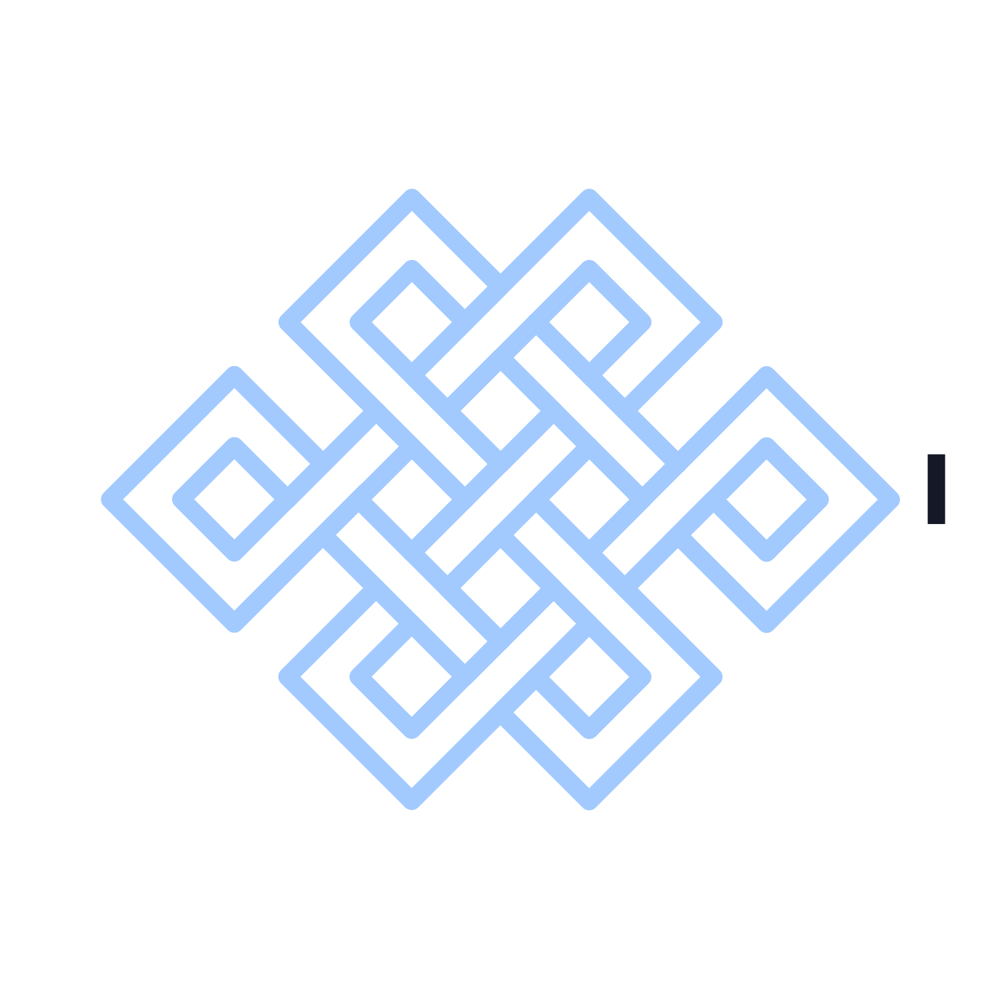

<p align="center">
  
</p>

<h1 align="center">COINWETON</h1>
<p align="center"><strong>Smart Crypto Tracker & AI Assistant</strong></p>

<p align="center">
  
  
  
  
  
</p>

---

## 📌 Tentang Proyek

**COINWETON** adalah platform pelacak pasar kripto (*crypto market tracker*) berbasis web yang dirancang sebagai solusi inovatif untuk mengatasi **krisis literasi keuangan digital di Indonesia**, khususnya fenomena *Fear of Missing Out* (FOMO) dan penyalahgunaan pinjaman online (*pinjol*) yang kerap menimpa investor kripto pemula. Dengan menyajikan data pasar secara transparan, terkurasi, dan mudah dipahami, COINWETON bertujuan memberdayakan pengguna agar mampu mengambil keputusan investasi berbasis data (*data-driven decision making*), bukan emosi. Proyek ini secara langsung mendukung pencapaian **Sustainable Development Goals (SDGs) ke-8: *Decent Work and Economic Growth***, melalui peningkatan literasi finansial dan inklusi ekonomi digital.

Lebih dari sekadar *price tracker* konvensional, COINWETON mengintegrasikan **asisten AI kontekstual (Cown AI)** yang mampu menganalisis data pasar secara *real-time*, serta menyediakan fitur **audit keamanan *smart contract* otomatis** untuk mendeteksi potensi penipuan (*scam/honeypot*). Kombinasi fitur unggulan ini menjadikan COINWETON sebuah terminal data kripto yang komprehensif, dirancang tidak hanya untuk menyajikan informasi, melainkan untuk **menginterpretasikannya** bagi pengguna.

---

## ✨ Fitur Unggulan

### 📊 Real-Time Market Dashboard
Dasbor utama menampilkan data pasar kripto global secara *real-time*, meliputi harga, kapitalisasi pasar, volume perdagangan 24 jam, dominasi Bitcoin, serta integrasi **Fear & Greed Index** untuk mengukur sentimen pasar terkini. Data disajikan dalam antarmuka *dark mode* yang profesional dan nyaman untuk penggunaan jangka panjang.

### 📈 Dual-Chart System
Sistem visualisasi data ganda yang mengintegrasikan dua *engine* grafik berbeda:
- **Recharts** - Grafik sparkline kustom untuk analisis tren cepat di halaman utama.
- **TradingView** - Grafik interaktif profesional di halaman detail koin untuk analisis teknikal mendalam, mendukung *timeframe* 1H, 24H, 7D, 30D, hingga 1 tahun.

### 🛡️ Smart Contract Security Audit
Fitur deteksi *scam* dan *honeypot* otomatis yang memanfaatkan **GoPlus Security API**. Setiap token berbasis EVM (Ethereum, BSC, Polygon, dll.) diaudit secara otomatis untuk memeriksa:
- Status **Honeypot** (apakah token dapat dijual kembali)
- Fungsi **Mint** (risiko inflasi tak terbatas)
- **Buy/Sell Tax** (biaya tersembunyi)
- Status **Owner Renounced** (desentralisasi kontrak)

Hasil audit ditampilkan sebagai *badge* visual dengan level risiko: `SAFE`, `CAUTION`, atau `DANGER`.

### 🤖 Cown AI - RAG-Based AI Assistant
Asisten AI cerdas yang ditenagai oleh arsitektur **Retrieval-Augmented Generation (RAG)** dengan dua tingkat konteks:
- **Macro RAG** - Menganalisis lanskap pasar global: Fear & Greed Index, tren kapitalisasi pasar, dan sentimen berita utama.
- **Micro RAG** - Mendalami data spesifik per koin: harga terkini, metrik fundamental, dan hasil audit keamanan kontrak.

Cown AI tidak hanya menjawab pertanyaan umum, melainkan memberikan analisis yang **dikontekstualisasikan** (*grounded*) dengan data pasar *real-time*, sehingga meminimalkan risiko halusinasi (*hallucination*).

### ⭐ Watchlist & Autentikasi
Sistem *watchlist* personal yang memungkinkan pengguna menyimpan koin favorit lintas perangkat, didukung oleh autentikasi **Google OAuth** melalui Supabase Auth.

---

## 🏗️ Arsitektur & Teknologi

### Tech Stack Utama

| Kategori | Teknologi | Keterangan |
|---|---|---|
| **Framework** | Next.js 16 (App Router) | React Server Components & Server Actions |
| **Bahasa** | TypeScript 5 | *Strict mode* untuk keamanan tipe data |
| **Styling** | Tailwind CSS 4 | Utility-first CSS framework |
| **UI Library** | Shadcn UI + Lucide Icons | Komponen UI *headless* yang dapat dikustomisasi |
| **Database** | PostgreSQL via Supabase | Region: `ap-southeast-1` (Singapore) |
| **ORM** | Drizzle ORM | *Type-safe* query builder untuk PostgreSQL |
| **Autentikasi** | Supabase Auth + `@supabase/ssr` | Google OAuth, session management |
| **State Management** | SWR | *Client-side* data fetching & caching |
| **Charts** | Recharts + TradingView Widget | Dual-chart rendering system |

### Integrasi API Pihak Ketiga

| Layanan | Fungsi | Tipe |
|---|---|---|
| **CoinGecko API** | Data pasar kripto *real-time* (harga, volume, kapitalisasi) | REST API |
| **GoPlus Security API** | Audit keamanan *smart contract* EVM | REST API |
| **OpenRouter** | Gateway ke model LLM untuk Cown AI | REST API |
| **NewsData API** | Agregasi berita kripto global | REST API |

### Diagram Arsitektur Tingkat Tinggi

```
┌──────────────────────────────────────────────────────────┐
│                     CLIENT (Browser)                      │
│          Next.js App Router — RSC + Client Components     │
│  ┌───────────┐  ┌──────────────┐  ┌──────────────────┐  │
│  │ Dashboard  │  │ Coin Detail  │  │ Cown AI Terminal │  │
│  └───────────┘  └──────────────┘  └──────────────────┘  │
└────────────────────────┬─────────────────────────────────┘
                         │ HTTP / Server Actions
┌────────────────────────▼─────────────────────────────────┐
│           NEXT.JS SERVER (API Route Handlers)             │
│                                                           │
│  /api/coins      → CoinGecko        (ISR cache 60s)      │
│  /api/market     → CoinGecko        (ISR cache 60s)      │
│  /api/news       → NewsData         (ISR cache 300s)     │
│  /api/chat       → OpenRouter LLM   (Streaming POST)     │
│  /api/highlights → CoinGecko        (ISR cache 120s)     │
│  /api/watchlist  → Drizzle ORM      (Auth required)      │
│                                                           │
│  ┌─────────────────┐    ┌────────────────────────────┐   │
│  │   Drizzle ORM   │    │   Supabase Auth (SSR)      │   │
│  └────────┬────────┘    └──────────────┬─────────────┘   │
└───────────┼────────────────────────────┼─────────────────┘
            │                            │
┌───────────▼────────────────────────────▼─────────────────┐
│              SUPABASE (ap-southeast-1, Singapore)         │
│          PostgreSQL: users, watchlists (RLS enabled)      │
└──────────────────────────────────────────────────────────┘
```

---

## 🚀 Panduan Instalasi Lokal 

Panduan berikut ditujukan bagi dewan juri atau pihak lain yang ingin menjalankan aplikasi COINWETON di perangkat lokal.

### Prasyarat

- **Node.js** versi 18.0 atau lebih tinggi - [Unduh di sini](https://nodejs.org/)
- **npm** (tersedia otomatis bersama instalasi Node.js)
- **Git** - [Unduh di sini](https://git-scm.com/)

### Langkah-Langkah Instalasi

**1. Clone repositori**
```bash
git clone https://github.com/chulopp/CoinWeton.git
cd CoinWeton
```

**2. Instal dependensi**
```bash
npm install
```

**3. Konfigurasi *Environment Variables***

Salin file template konfigurasi, lalu isi dengan kunci API yang diperlukan:

```bash
cp .env.example .env.local
```

Buka file `.env.local` dan lengkapi setiap variabel sesuai petunjuk di dalamnya. Berikut keterangan singkat untuk setiap variabel:

| Variabel | Sumber | Keterangan |
|---|---|---|
| `NEXT_PUBLIC_SUPABASE_URL` | [Supabase Dashboard](https://supabase.com) | URL proyek Supabase |
| `NEXT_PUBLIC_SUPABASE_PUBLISHABLE_KEY` | Supabase Dashboard | *Anon/public key* |
| `DATABASE_URL` | Supabase Dashboard | Connection string (port 6543, *transaction mode*) |
| `DIRECT_URL` | Supabase Dashboard | Connection string (port 5432, *direct*) |
| `COINGECKO_API_KEY` | [CoinGecko](https://www.coingecko.com/en/api) | API key (free tier) |
| `NEWSDATA_API_KEY` | [NewsData.io](https://newsdata.io/) | API key untuk berita |
| `GOPLUS_API_BASE` | - | `https://api.gopluslabs.io/api/v1` |
| `OPENROUTER_API_KEY` | [OpenRouter](https://openrouter.ai/) | API key untuk Cown AI |
| `CLIENT_ID` / `CLIENT_SECRET` | [Google Cloud Console](https://console.cloud.google.com/) | OAuth 2.0 credentials |

**4. Jalankan *development server***
```bash
npm run dev
```

**5. Akses aplikasi**

Buka browser dan navigasi ke alamat berikut:
```
http://localhost:3000
```

> **Catatan:** Pastikan koneksi internet aktif, karena aplikasi membutuhkan akses ke API eksternal (CoinGecko, GoPlus, OpenRouter) untuk menampilkan data secara *real-time*.

---

## 📂 Struktur Proyek

```
CoinWeton/
├── src/
│   ├── app/                    # Next.js App Router (pages & API routes)
│   │   ├── api/                # Server-side API proxy routes
│   │   │   ├── chat/           # Cown AI endpoint (OpenRouter)
│   │   │   ├── coins/          # CoinGecko market data proxy
│   │   │   ├── highlights/     # Trending & gainers data
│   │   │   ├── market/         # Global market statistics
│   │   │   ├── news/           # NewsData aggregation
│   │   │   ├── search/         # Coin search endpoint
│   │   │   └── watchlist/      # CRUD watchlist (auth required)
│   │   ├── coins/[id]/         # Halaman detail koin (dynamic route)
│   │   ├── cown-ai/            # Halaman terminal Cown AI
│   │   ├── watchlist/          # Halaman watchlist pengguna
│   │   └── page.tsx            # Halaman utama (dashboard)
│   ├── components/             # Komponen UI React
│   │   ├── coin-detail/        # Komponen detail koin & chart
│   │   ├── highlights/         # Kartu trending, gainers, Fear & Greed
│   │   ├── layout/             # Navbar, Footer
│   │   ├── market/             # Tabel pasar utama
│   │   └── ui/                 # Shadcn UI base components
│   ├── db/                     # Drizzle ORM schema & connection
│   ├── lib/                    # Utility & data fetching functions
│   └── utils/                  # Supabase client utilities
├── drizzle/                    # Database migration files
├── data/                       # Dokumentasi internal (PRD, user flows)
├── public/                     # Aset statis (logo, ikon)
├── .env.example                # Template environment variables
├── drizzle.config.ts           # Konfigurasi Drizzle ORM
├── next.config.ts              # Konfigurasi Next.js
├── package.json                # Dependensi & scripts
└── tsconfig.json               # Konfigurasi TypeScript
```

---

## 👥 Tim Pengembang

Proyek ini dikembangkan oleh mahasiswa **Universitas Diponegoro**:

| Nama | Peran |
|---|---|
| **Fallah Iqbal Kurnianto** | Lead Developer & System Architect |

---

## 📜 Lisensi & Pengakuan

Proyek ini dilisensikan di bawah **MIT License**.

Terima kasih kepada penyedia infrastruktur data yang mendukung platform ini:

<p align="center">
  &nbsp;&nbsp;&nbsp;
  &nbsp;&nbsp;&nbsp;
  <strong>OpenRouter</strong>&nbsp;&nbsp;&nbsp;
  <strong>NewsData.io</strong>&nbsp;&nbsp;&nbsp;
  
</p>

---

<p align="center">
  <em>Dibangun dengan ❤️ dari Universitas Diponegoro</em>
</p>
