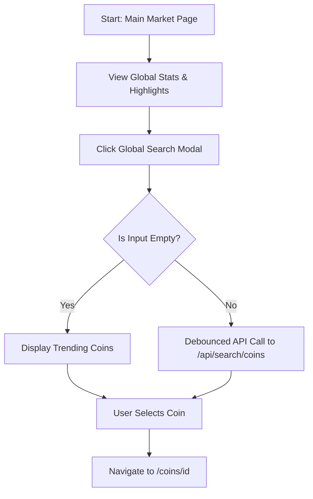
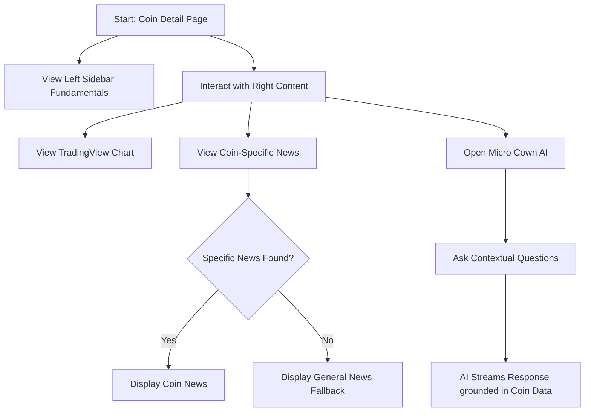
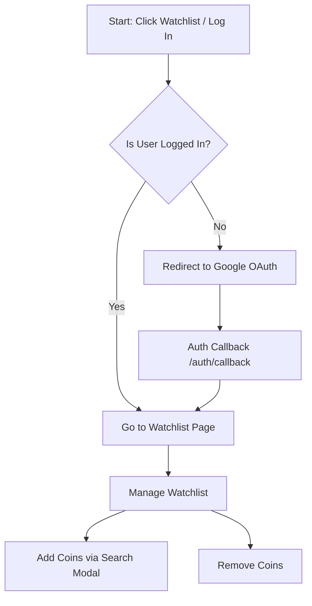
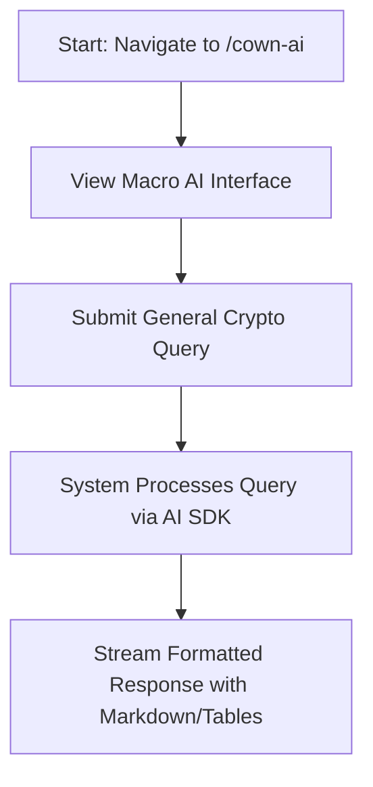

# COINWETON - Complete User Flow Document

### 1. User Personas
* **Guest User (Unauthenticated):** Can browse markets, view coin details, read news, and interact with the AI, but lacks personalization.
* **Registered User (Authenticated):** Logged in via Google OAuth (Supabase), has access to the Watchlist and personalized tracking.

### 2. Core User Journeys (The Flows)

#### Flow A: Market Discovery (Entry Point)
1. User lands on the **Main Market Page** (`/`).
2. User views the **Global Market Stats** bar to check high-level crypto market performance.
3. User interacts with the Highlights section:
   * Views the mini-chart in **Global Market Cap Card**.
   * Checks the top 7 **Trending Coins**.
   * Checks the **Top Gainers**.
4. User wants to search for a specific coin.
   * User clicks the **Global Search Modal** button in the Navbar.
   * By default, the modal displays the list of Trending Coins.
   * User types a query; the app makes a debounced API call to fallback to a full CoinGecko search (`/api/search/coins`).
   * User selects a coin from the results and is navigated to `/coins/[id]`.

#### Flow B: Deep Dive Analysis (Coin Detail Page)
1. User navigates from the Market list or Search Modal to a specific **Coin Detail Page** (`/coins/[id]`).
2. User interacts with the independent scrolling UI:
   * **Left Sidebar:** Scrolls independently to display the fundamental metrics, current price, 24h range, circulating supply, and contract addresses.
   * **Right Content:** Contains the main interactive sections.
3. User interacts with the Right Content Tabs:
   * **Chart Tab:** Views the TradingView chart, changing timeframes and chart types (Line/OHLC).
   * **News Tab:** Reads Coin-specific News fetched via CryptoPanic. (Fallback: if no specific news is available, general crypto news is displayed).
   * **Micro Cown AI:** User clicks on the AI consultation button to ask contextual questions about the specific coin. The AI provides insights using live data from the coin context.

#### Flow C: Authentication & Watchlist (Conversion Loop)
1. The trigger: Guest user clicks **"Watchlist"** or **"Log In"** from the Global Navbar or clicks "Add to Watchlist" on a Coin Detail page.
2. The Auth flow:
   * System redirects the user to the Supabase Google OAuth provider.
   * After successful authentication, user is returned to the callback route (`/auth/callback/route.ts`).
   * System redirects the authenticated user to the **Watchlist Page** (`/watchlist`).
3. Managing the Watchlist:
   * User is on the personalized Watchlist.
   * User clicks "Add coin" and opens the Search Modal within the Watchlist.
   * User types a query, selects multiple coins, and saves them to the database.
   * User can manage their portfolio by removing coins via the "Remove coin" UI.

#### Flow D: Macro AI Consultation
1. User navigates to the main Macro RAG page: **`/cown-ai`**.
2. User sees the Cown AI consultation interface.
3. User submits a general crypto query (e.g., "What is the sentiment for Bitcoin today?").
4. System streams text responses, correctly formatting tabular data using GitHub Flavored Markdown standards.
5. User reads the response, generated by the AI model.

### 3. Edge Cases & Fallbacks
* **Unauthenticated Watchlist Access:**
  * Trying to access the Watchlist (`/watchlist`) without logging in triggers a fallback UI state displaying a lock icon and "Watchlist is Private. Please login to view your saved coins". This handles cases where middleware redirection fails or the user directly navigates to the page client-side.
* **Empty Search Results:**
  * Searching for a coin that doesn't exist displays a fallback modal empty state with a message "No coins found for [query]".
* **News Fallback:**
  * Opening a coin detail page that lacks specific news defaults to fetching and displaying general cryptocurrency news, maintaining the specific coin's heading layout to avoid a broken UI state.
* **API Rate Limits / Data Fetching Failures:**
  * Data fetching relies on ISR caching to prevent rate-limiting. If the watchlist or live coin data fails to refresh, the SWR hook displays a subtle retry message: "Refresh issue detected. Retrying shortly while keeping the last snapshot," ensuring a non-disruptive UX.
